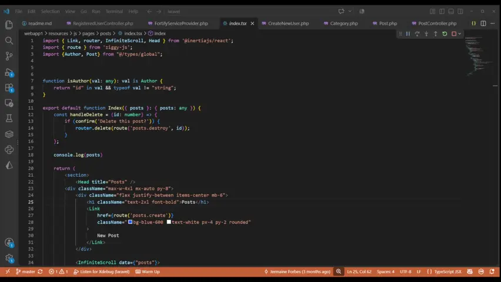
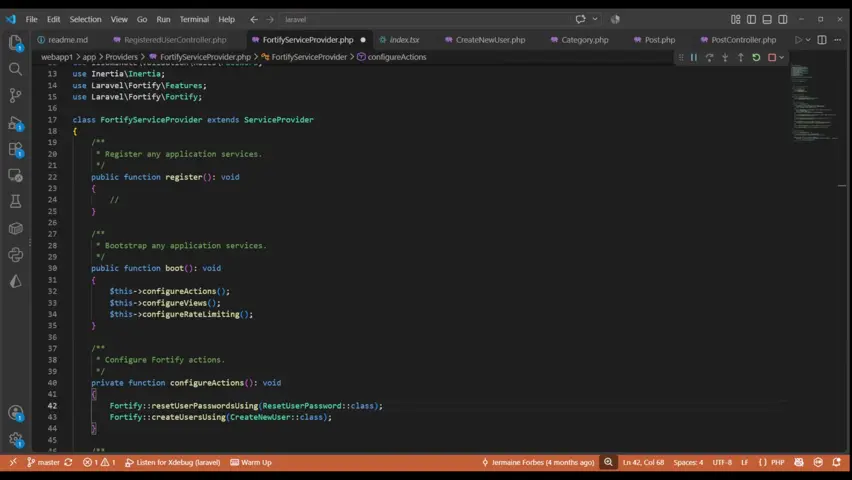
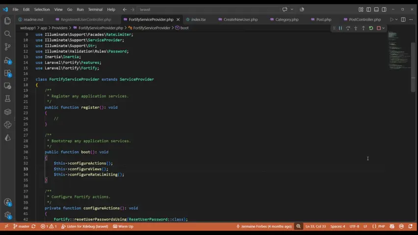

# VSCode Shortcuts
A collection of different shortcut keys that make it easier to use vscode

[home]:#vscode-shortcuts
[comment-out-lines]:#comment-out-lines
[delete-lines]:#delete-lines
[duplicate-lines]:#duplicate-lines
[find-a-symbol]:#find-a-symbol

Description | Windows Command | Mac Command 
--|--|--
[Comment out lines][comment-out-lines] | ctrl + / | cmd + /
[Delete lines][delete-lines] | ctrl + shift + K | cmd + shift + K
[Duplicate lines][duplicate-lines] | alt + shift + :arrow_up:/:arrow_down: | option + shift + :arrow_up:/:arrow_down:
[Find a symbol][find-a-symbol] | ctrl + shift + O | ctrl + shift + O
Find and replace | ctrl + F | cmd + F
Format code | alt + shift + F | option + shift + F
Go to definition | ctrl + click | cmd + click
Highlight a line | ctr + L | cmd + L
Indent | tab | tab
Moving lines | alt + :arrow_up:/:arrow_down: | option + :arrow_up:/:arrow_down:
Multiple cursors | ctrl + alt + :arrow_up:/:arrow_down: | cmd + option + :arrow_up:/:arrow_down:
Quick open | ctrl + P | cmd + P
Reverse indent | shift + tab | shift + tab
Select all occurrences | ctrl + shift + L | cmd + shift + L

### Find a symbol

View Content

Find different symbols within your document

[go back :house:][home]

### Duplicate lines

View Content

Duplicate lines of code

[go back :house:][home]

### Delete lines

View Content

Delete lines of code

[go back :house:][home]

### Comment out lines

View Content

Comment lines of code

[go back :house:][home]

