# VSCode Shortcuts
A collection of different shortcut keys that make it easier to use vscode

[home]:#vscode-shortcuts
[comment-out-lines]:#comment-out-lines
[delete-lines]:#delete-lines
[duplicate-lines]:#duplicate-lines
[find-a-symbol]:#find-a-symbol
[find-and-replace]:#find-and-replace
[format-code]:#format-code
[go-to-definition]:#go-to-definition
[highlight-a-line]:#highlight-a-line
[indent]:#indent
[moving-lines]:#moving-lines
[multiple-cursors]:#multiple-cursors
[quick-open]:#quick-open
[reverse-indent]:#reverse-indent
[select-all-occurrences]:#select-all-occurrences
[toggle-terminal]:#toggle-terminal
[toggle-sidebar]:#toggle-sidebar
[switch-tabs]:#switch-tabs
[mru-list]:#mru-list

Description | Windows Command | Mac Command 
--|--|--
[Comment out lines][comment-out-lines] | <kbd><kbd>ctrl</kbd></kbd>+<kbd>/</kbd> |  <kbd>cmd</kbd> + <kbd>/</kbd>
[Delete lines][delete-lines] | <kbd><kbd>ctrl</kbd></kbd> + <kbd><kbd>shift</kbd></kbd> + <kbd>K</kbd> | <kbd>cmd</kbd> + <kbd>shift</kbd> + <kbd>K</kbd>
[Duplicate lines][duplicate-lines] | <kbd>alt</kbd> + <kbd>shift</kbd> + :arrow_up:/:arrow_down:  | <kbd>option</kbd> + <kbd>shift</kbd> + :arrow_up:/:arrow_down: 
[Find a symbol][find-a-symbol] | <kbd>ctrl</kbd> + <kbd>shift</kbd> + <kbd>O</kbd>  | <kbd>ctrl</kbd> + <kbd>shift</kbd> + <kbd>O</kbd> 
[Find and replace][find-and-replace] | <kbd>ctrl</kbd> + <kbd>F</kbd>| <kbd>cmd</kbd> + <kbd>F</kbd>
[Format code][format-code] | <kbd>alt</kbd> + <kbd>shift</kbd> + <kbd>F</kbd>| <kbd>option</kbd> + <kbd>shift</kbd> + <kbd>F</kbd>
[Go to definition][go-to-definition] | <kbd>ctrl</kbd> + click | <kbd>cmd</kbd> + click 
[Highlight a line][highlight-a-line] | <kbd>ctrl</kbd>+ <kbd>L</kbd> | <kbd>cmd</kbd> + <kbd>L</kbd> 
[Indent][indent] | <kbd>tab</kbd> | <kbd>tab</kbd> 
[Moving lines][moving-lines] | <kbd>alt</kbd> + :arrow_up:/:arrow_down:  | <kbd>option</kbd> + :arrow_up:/:arrow_down: 
[MRU list][mru-list] | <kbd><kbd>ctrl</kbd></kbd> + <kbd>tab</kbd> | <kbd>cmd</kbd> + <kbd>tab</kbd> 
[Multiple cursors][multiple-cursors] | <kbd>ctrl</kbd> + <kbd>alt</kbd> + :arrow_up:/:arrow_down:  | <kbd>cmd</kbd> + <kbd>option</kbd> + :arrow_up:/:arrow_down: 
[Quick open][quick-open] | <kbd>ctrl</kbd> + <kbd>P</kbd> | <kbd>cmd</kbd> + <kbd>P</kbd>
[Reverse indent][reverse-indent] | <kbd>shift</kbd> + <kbd>tab</kbd> | <kbd>shift</kbd> + <kbd>tab</kbd>
[Switch tabs][switch-tabs] | <kbd>ctrl</kbd>  + <kbd>page up</kbd>/<kbd>page down</kbd> | <kbd>cmd</kbd> + <kbd>page up</kbd>/<kbd>page down</kbd>
[Toggle terminal][toggle-terminal] | <kbd>ctrl</kbd> + <kbd>\`</kbd> | <kbd>cmd</kbd> +   <kbd>\`</kbd> 
[Toggle sidebar][toggle-sidebar] | <kbd>ctrl</kbd> + <kbd>B</kbd>   | <kbd>cmd</kbd> + <kbd>B</kbd>   

### Toggle terminal

View Content

Toggle the terminal

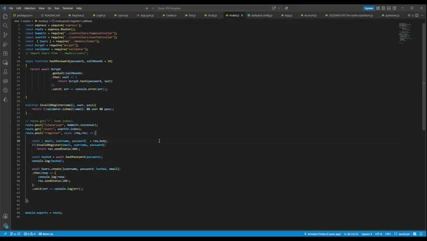

[go back :house:][home]

### Toggle sidebar

View Content

 toggle the left sidebar

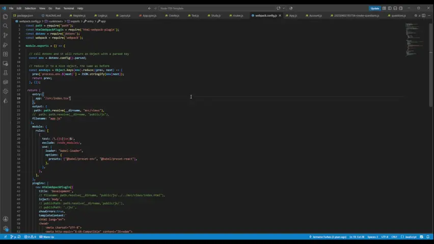

[go back :house:][home]

### Switch tabs

View Content

Switch through the different tabs that are already opened in the editor

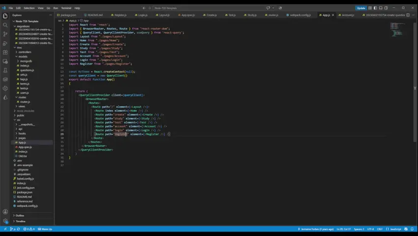

[go back :house:][home]

### MRU list

View Content

 Select through a list of the most recently used files within this list. You can use up/down arrow keys to navigate through the list or use the right arrow key to open the content of a file

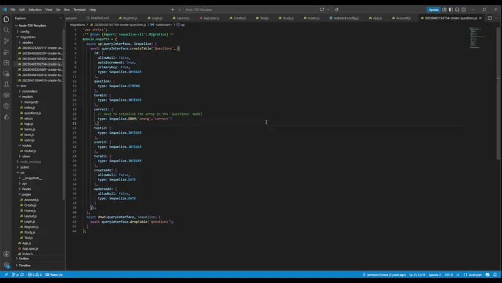

[go back :house:][home]

### Select all occurrences

View Content

 Highlight a word or character and find the same words within the document that will allow you to make an edit of them

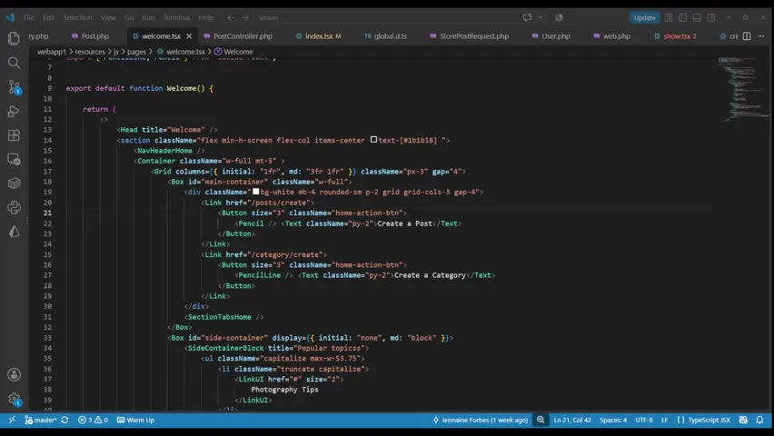

[go back :house:][home]

### Reverse indent

View Content

 Self explanatory

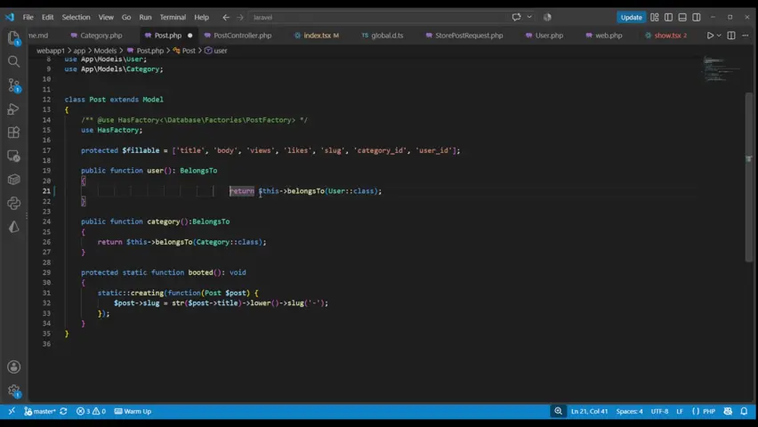

[go back :house:][home]

### Quick open

View Content

 Quick open let's you search for a file, look at the most recent files you opened, find a symbol in the current file, go to a specific line in the current file

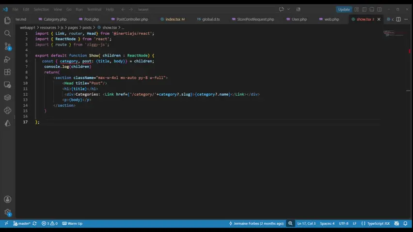

[go back :house:][home]

### Multiple cursors

View Content

Create multiple cursors on the document

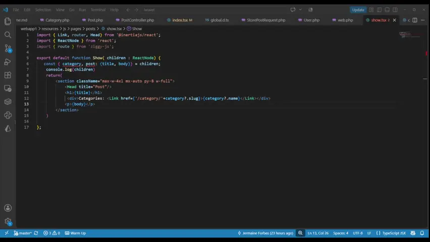

[go back :house:][home]

### Moving Lines

View Content

**Note**
In order to highlight multiple lines you have to first do (<kbd>ctrl</kbd>+ <kbd>L</kbd> | <kbd>cmd</kbd> + <kbd>L</kbd>), then hold the <kbd>shift</kbd> button and use the up/down arrow keys

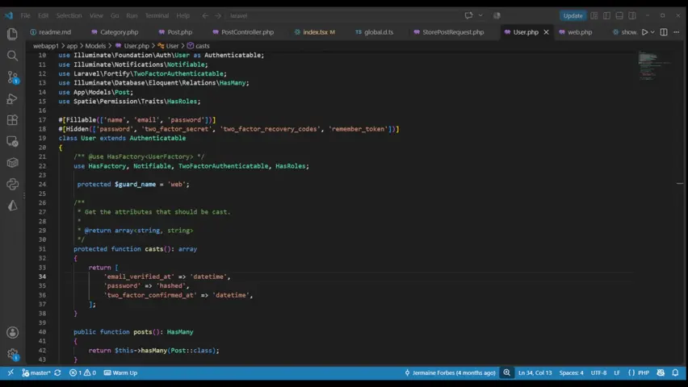

[go back :house:][home]

### Indent

View Content

Move your code horizontally with this command

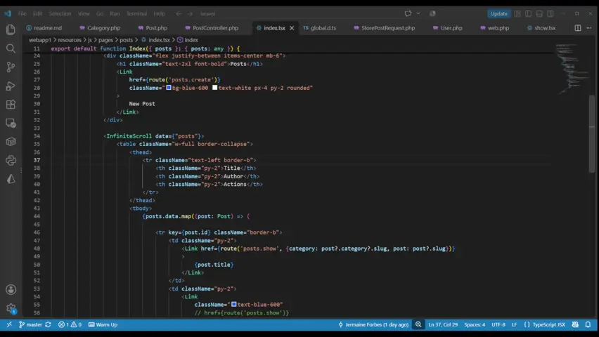

[go back :house:][home]

### Highlight a line

View Content

Select or highlight lines with this command

**Note**
If you hold the <kbd>shift</kbd> key and press up/down arrow keys you can highlight multiples lines

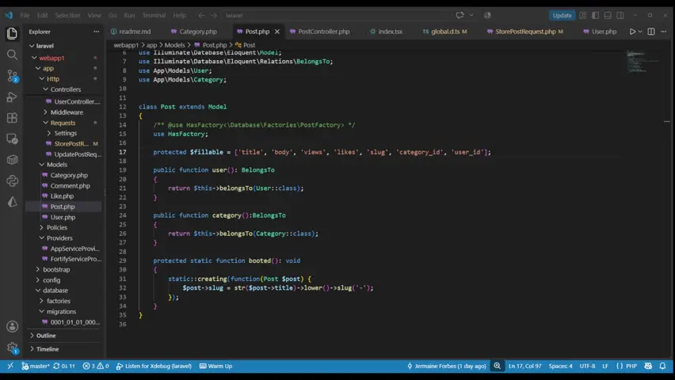

[go back :house:][home]

### Go to definition

View Content

Clicking on the different functions, classes, or other components within the code can bring up a window that shows the programmatic logic behind that component/feature or it will open up the page itself.

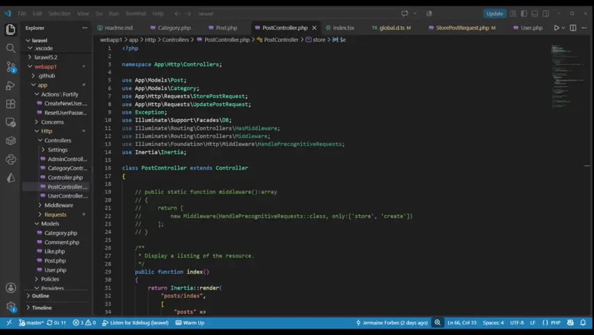

[go back :house:][home]

### Format code

View Content

**Note**
You can only use this command if you already have an extension that beautifies or allows you to format your code properly.

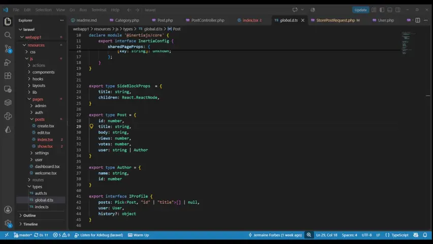

[go back :house:][home]

### Find and replace

View Content

There are many different options that allow you find all words that are in a document. You could also find the word with the exact formatting, replace one, or replace all matching words if you so choose to

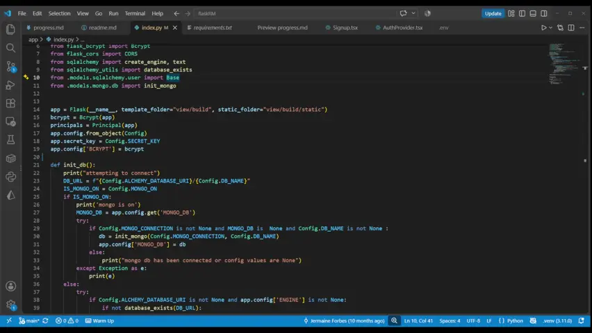

[go back :house:][home]

### Find a symbol

View Content

Find different symbols within your document

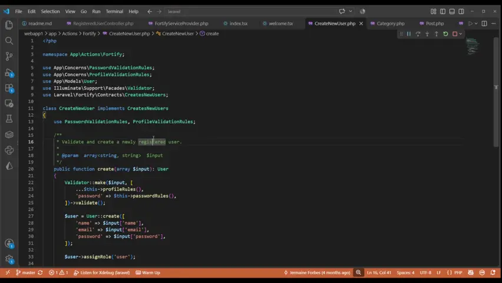

[go back :house:][home]

### Duplicate lines

View Content

Duplicate lines of code

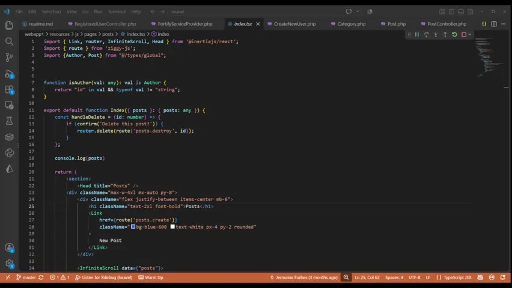

[go back :house:][home]

### Delete lines

View Content

Delete lines of code

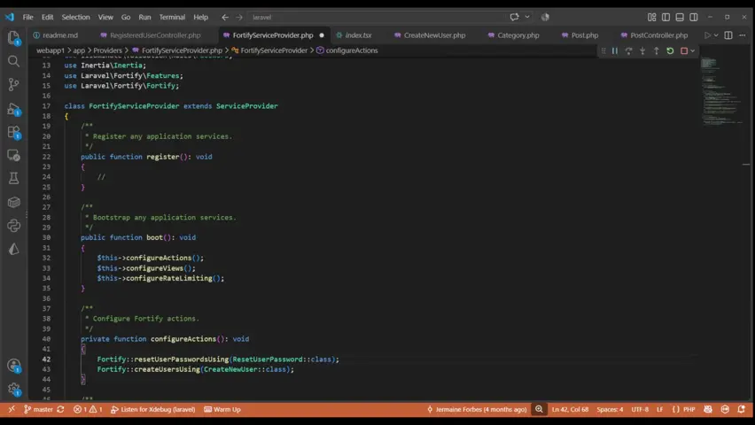

[go back :house:][home]

### Comment out lines

View Content

Comment lines of code

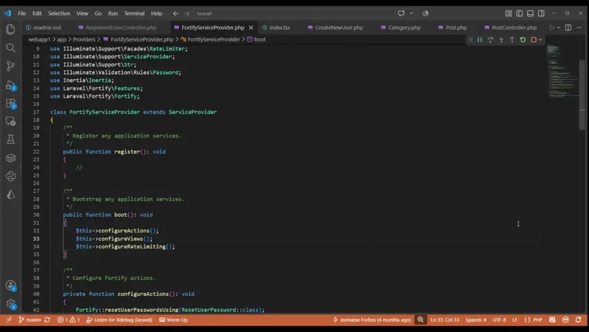

[go back :house:][home]

